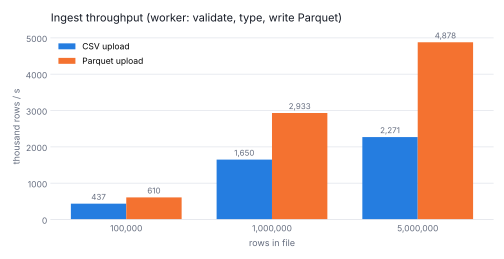
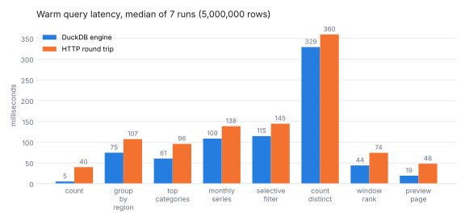
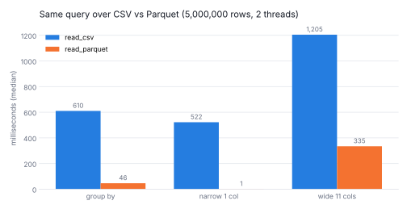

# Facet benchmark report

Generated from [`results/latest.json`](results/latest.json) by `report.py`. 
All figures are measured on the machine below. Nothing is extrapolated.

## Environment

| | |
|---|---|
| Run at (UTC) | 2026-11-26T00:47:30+00:00 |
| Git revision | `e27c030` |
| CPU | Intel(R) Xeon(R) Processor @ 2.10GHz, 4 logical CPUs |
| Memory | 15.7 GiB |
| OS | Linux-6.18.44-fc-v880-x86_64-with-glibc2.39 |
| Python / DuckDB / sqlglot | 3.13.18 / 2.0.1 / 30.35.0 |
| PostgreSQL | psql (PostgreSQL) 16.15 (Ubuntu 16.15-0ubuntu0.24.04.1) |
| Query sandbox limits | 1GB memory, 30.0 s timeout, 4 concurrent sandboxes |

> Shared cloud VM; numbers include noise from co-tenants. API, worker, PostgreSQL and this client all ran on the same machine.

## Data

Synthetic orders tables from `generate.py`: 11 columns (BIGINT, TIMESTAMP, DATE, 4 × VARCHAR, INTEGER, DOUBLE, BOOLEAN, DOUBLE), skewed category cardinality, 5% nulls in two columns. Every value is a hash of (row, seed), so files are reproducible byte-for-byte.

| Rows | CSV size | Parquet size (zstd) |
|---:|---:|---:|
| 100,000 | 8.4 MiB | 1.8 MiB |
| 1,000,000 | 86.2 MiB | 18.0 MiB |
| 5,000,000 | 437.8 MiB | 92.0 MiB |

## Ingestion

Upload streams the file to disk through the API, then a worker validates it, infers types, records rejected rows and writes zstd Parquet. *Worker* time is the job's own start→finish; *end to end* also includes the upload, queueing and polling. RSS figures are the peak increase over the process tree's baseline while the file was ingested, sampled every 50 ms, with the absolute peak in brackets (API includes its pre-forked sandbox processes). The API's memory does not grow with file size because uploads are streamed to disk in chunks; the worker's growth is DuckDB's CSV reader and Parquet writer, bounded by its memory limit.

| Rows | Input | Upload | Worker | End to end | Rows/s (worker) | API peak RSS Δ | Worker peak RSS Δ |
|---:|---|---:|---:|---:|---:|---:|---:|
| 100,000 | CSV (8.4 MiB) | 0.05 s | 0.23 s | 0.70 s | 436,681 | 0.0 MiB (of 401) | 34.9 MiB (of 180) |
| 100,000 | Parquet (1.8 MiB) | 0.02 s | 0.16 s | 0.67 s | 609,756 | 0.0 MiB (of 401) | 32.0 MiB (of 177) |
| 1,000,000 | CSV (86.2 MiB) | 0.25 s | 0.61 s | 0.90 s | 1,650,165 | 0.0 MiB (of 403) | 283.4 MiB (of 428) |
| 1,000,000 | Parquet (18.0 MiB) | 0.06 s | 0.34 s | 0.94 s | 2,932,551 | 0.0 MiB (of 403) | 191.6 MiB (of 398) |
| 5,000,000 | CSV (437.8 MiB) | 1.31 s | 2.20 s | 3.62 s | 2,270,663 | 0.0 MiB (of 408) | 603.4 MiB (of 752) |
| 5,000,000 | Parquet (92.0 MiB) | 0.29 s | 1.02 s | 2.91 s | 4,878,049 | 0.0 MiB (of 408) | 379.4 MiB (of 601) |



## Profiling

| Rows | Profile time (worker) | Sampled? |
|---:|---:|---|
| 100,000 | 0.17 s | no, exact |
| 1,000,000 | 0.52 s | no, exact |
| 5,000,000 | 1.84 s | no, exact |

## SQL query latency

Each query was run once cold (first run after ingest) and then repeated. *Engine* is DuckDB execution inside the sandbox, including writing the capped result to a temp table. *API* is the server-side total, including SQL validation, sandbox dispatch and history logging. *Round trip* is measured by the HTTP client. Medians and p95 of warm runs.


**100,000 rows**

| Query | Rows out | Cold engine | Warm engine p50 | Warm engine p95 | Warm API p50 | Warm round trip p50 |
|---|---:|---:|---:|---:|---:|---:|
| `count` | 1 | 3.8 ms | 3.9 ms | 4.1 ms | 24.0 ms | 32.0 ms |
| `group_by_region` | 5 | 9.0 ms | 9.9 ms | 11.9 ms | 31.3 ms | 39.9 ms |
| `top_categories` | 20 | 9.5 ms | 8.4 ms | 9.2 ms | 29.1 ms | 37.3 ms |
| `monthly_series` | 24 | 11.8 ms | 11.2 ms | 11.6 ms | 32.6 ms | 41.1 ms |
| `selective_filter` | 4 | 16.5 ms | 16.6 ms | 18.7 ms | 38.6 ms | 47.6 ms |
| `count_distinct` | 1 | 13.0 ms | 12.9 ms | 22.1 ms | 34.7 ms | 42.9 ms |
| `window_rank` | 15 | 9.7 ms | 9.3 ms | 11.2 ms | 31.4 ms | 38.9 ms |
| `preview_page` | 100 | 15.3 ms | 15.4 ms | 15.8 ms | 36.9 ms | 46.3 ms |

**1,000,000 rows**

| Query | Rows out | Cold engine | Warm engine p50 | Warm engine p95 | Warm API p50 | Warm round trip p50 |
|---|---:|---:|---:|---:|---:|---:|
| `count` | 1 | 3.8 ms | 3.7 ms | 6.0 ms | 27.7 ms | 38.7 ms |
| `group_by_region` | 5 | 21.1 ms | 19.8 ms | 23.0 ms | 42.8 ms | 51.5 ms |
| `top_categories` | 20 | 18.8 ms | 20.4 ms | 22.2 ms | 43.6 ms | 51.2 ms |
| `monthly_series` | 24 | 29.1 ms | 29.2 ms | 30.1 ms | 49.7 ms | 58.2 ms |
| `selective_filter` | 5 | 40.8 ms | 41.6 ms | 48.3 ms | 63.5 ms | 71.7 ms |
| `count_distinct` | 1 | 62.5 ms | 64.3 ms | 71.8 ms | 86.0 ms | 94.2 ms |
| `window_rank` | 15 | 25.4 ms | 19.2 ms | 21.6 ms | 45.8 ms | 54.9 ms |
| `preview_page` | 100 | 20.3 ms | 21.8 ms | 24.9 ms | 49.5 ms | 57.9 ms |

**5,000,000 rows**

| Query | Rows out | Cold engine | Warm engine p50 | Warm engine p95 | Warm API p50 | Warm round trip p50 |
|---|---:|---:|---:|---:|---:|---:|
| `count` | 1 | 5.3 ms | 5.4 ms | 55.0 ms | 29.0 ms | 40.0 ms |
| `group_by_region` | 5 | 64.8 ms | 74.7 ms | 88.3 ms | 95.9 ms | 107 ms |
| `top_categories` | 20 | 66.9 ms | 60.6 ms | 68.1 ms | 85.5 ms | 96.0 ms |
| `monthly_series` | 24 | 108 ms | 109 ms | 114 ms | 131 ms | 138 ms |
| `selective_filter` | 3 | 111 ms | 115 ms | 150 ms | 136 ms | 145 ms |
| `count_distinct` | 1 | 292 ms | 329 ms | 345 ms | 351 ms | 360 ms |
| `window_rank` | 15 | 46.6 ms | 44.0 ms | 44.3 ms | 66.3 ms | 74.4 ms |
| `preview_page` | 100 | 21.4 ms | 19.2 ms | 23.2 ms | 40.8 ms | 48.1 ms |



<details><summary>Benchmark queries</summary>

- `count`: `SELECT count(*) FROM bench_100000_csv`
- `group_by_region`: `SELECT region, sum(qty * unit_price) AS revenue, count(*) AS n FROM bench_100000_csv GROUP BY region ORDER BY revenue DESC`
- `top_categories`: `SELECT category, sum(qty * unit_price) AS revenue FROM bench_100000_csv GROUP BY category ORDER BY revenue DESC LIMIT 20`
- `monthly_series`: `SELECT date_trunc('month', ordered_at) AS m, sum(qty) AS units FROM bench_100000_csv GROUP BY 1 ORDER BY 1`
- `selective_filter`: `SELECT * FROM bench_100000_csv WHERE customer_id = 'cust_123' ORDER BY order_id`
- `count_distinct`: `SELECT count(DISTINCT customer_id) FROM bench_100000_csv`
- `window_rank`: `SELECT * FROM (SELECT region, category, sum(qty) AS units, rank() OVER (PARTITION BY region ORDER BY sum(qty) DESC) AS r FROM bench_100000_csv GROUP BY region, category) WHERE r <= 3 ORDER BY region, r`
- `preview_page`: `SELECT * FROM bench_100000_csv LIMIT 100`

</details>

### Fixed per-query cost of isolation

Each query gets a fresh, locked-down in-memory DuckDB (allowed paths, no external access, configuration locked) in a pre-forked worker process. Opening and closing that connection with one Parquet view, measured in-process:

| Rows | p50 | p95 |
|---:|---:|---:|
| 100,000 | 17.2 ms | 20.1 ms |
| 1,000,000 | 16.2 ms | 19.2 ms |
| 5,000,000 | 17.2 ms | 23.6 ms |

SQL guard (parse with sqlglot, walk the AST, re-render) over 2,000 iterations: 178–838 µs per query (`count` 191 µs, `window_rank` 838 µs).

## Concurrency

More clients than sandbox slots, all running `top_categories`. Requests that cannot get a slot within the acquire timeout receive HTTP 503.

| Rows | Clients | Requests | Status codes | Wall time | Throughput | Round trip p50 / p95 |
|---:|---:|---:|---|---:|---:|---:|
| 100,000 | 8 | 32 | 200: 32 | 0.37 s | 86.9 q/s | 81.2 / 120 ms |
| 1,000,000 | 8 | 32 | 200: 32 | 0.65 s | 48.9 q/s | 155 / 202 ms |
| 5,000,000 | 8 | 32 | 200: 32 | 1.21 s | 26.4 q/s | 286 / 351 ms |

## Exports

Full-dataset export as a background job (CSV includes formula-injection sanitising of text cells).

| Rows | Format | Worker | End to end | Rows/s (worker) | File size | Worker peak RSS Δ |
|---:|---|---:|---:|---:|---:|---:|
| 100,000 | CSV | 0.15 s | 0.36 s | 645,161 | 8.4 MiB | 34.3 MiB |
| 100,000 | PARQUET | 0.14 s | 0.67 s | 699,301 | 1.8 MiB | 29.3 MiB |
| 1,000,000 | CSV | 0.88 s | 1.31 s | 1,141,553 | 86.2 MiB | 130.2 MiB |
| 1,000,000 | PARQUET | 0.79 s | 1.31 s | 1,265,823 | 18.0 MiB | 122.8 MiB |
| 5,000,000 | CSV | 4.38 s | 4.76 s | 1,140,771 | 437.8 MiB | 324.8 MiB |
| 5,000,000 | PARQUET | 3.64 s | 4.13 s | 1,375,138 | 92.1 MiB | 306.3 MiB |

## Why store Parquet: same query over CSV vs Parquet

In-process DuckDB with the sandbox's memory limit and 2 threads, OS cache warm. Medians.

| Rows | Query | read_csv | read_parquet | Ratio (CSV ÷ Parquet) |
|---:|---|---:|---:|---:|
| 100,000 | group by | 62.2 ms | 3.4 ms | 18.2× |
| 100,000 | narrow 1 col | 75.6 ms | 0.8 ms | 95.8× |
| 100,000 | wide 11 cols | 103 ms | 14.9 ms | 6.9× |
| 1,000,000 | group by | 169 ms | 11.9 ms | 14.3× |
| 1,000,000 | narrow 1 col | 153 ms | 0.9 ms | 172.5× |
| 1,000,000 | wide 11 cols | 301 ms | 80.5 ms | 3.7× |
| 5,000,000 | group by | 610 ms | 46.4 ms | 13.1× |
| 5,000,000 | narrow 1 col | 522 ms | 1.2 ms | 427.0× |
| 5,000,000 | wide 11 cols | 1,205 ms | 335 ms | 3.6× |



## Reproduce

```bash
# terminal 1-2: API and worker (see README)
cd backend
uv run --group bench python ../benchmarks/run.py --rows 100000 1000000 5000000
uv run --group bench python ../benchmarks/report.py
```

## Caveats

- One shared cloud VM; the API, worker, PostgreSQL and the load generator compete for the same 4 vCPUs. Expect run-to-run variation; compare runs from the same machine.
- Upload time is loopback HTTP, so it measures the server's streaming path, not a real network.
- RSS is sampled every 50 ms; very short spikes can be missed.
- Warm query numbers benefit from the OS page cache holding the Parquet file.
