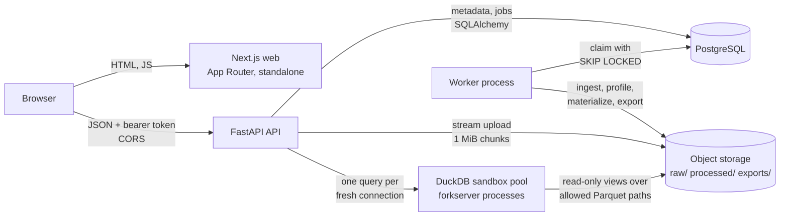

# Architecture

Facet has four processes and two kinds of storage. PostgreSQL holds metadata and the job
queue. Analytical data lives in Parquet files and is only ever read by DuckDB.



The browser calls the API directly at `NEXT_PUBLIC_API_URL`. The Next.js server only serves
the UI, so it never proxies data. Export downloads are plain links signed with HMAC, which
lets the browser's own download manager handle large files.

## Request paths

### Upload to queryable dataset

```mermaid
sequenceDiagram
    participant UI
    participant API
    participant PG as PostgreSQL
    participant FS as Storage
    participant WK as Worker
    UI->>API: POST /datasets?filename=… (raw body)
    API->>FS: write raw/{ws}/{ds}/{ver}/original.csv (streamed, size-capped, sha256)
    API->>PG: INSERT dataset, version, job(ingest) in ONE transaction
    API-->>UI: 202 {dataset, job_id}
    WK->>PG: SELECT … FOR UPDATE SKIP LOCKED (lease 60 s)
    WK->>FS: DuckDB read_csv → validate → processed/…/data.parquet.tmp
    loop every ≤15 s
        WK->>PG: heartbeat(progress, lease)
    end
    WK->>FS: atomic rename .tmp → data.parquet
    WK->>PG: version ready, schema + row count; enqueue profile
    UI->>API: GET /datasets/{id} (poll) → ready
```

Because the dataset row and its ingest job are created in the same transaction, there is
no state where a dataset exists without a job or a job points at nothing. If a worker
dies, its lease expires and another worker reclaims the job, up to `job_max_attempts`.
After the last failed attempt, `on_final_failure` marks the dataset or export as failed.

### SQL query

1. **Guard** (`app/analytics/sql_guard.py`): sqlglot parses the query in the DuckDB
   dialect. The guard requires exactly one read-only statement and rejects forbidden node
   types and denied functions. Every table reference must be a CTE or one of the caller's
   own dataset names. The validated tree is **re-rendered**, so DuckDB never sees the raw
   text.
2. **Sandbox** (`app/analytics/sandbox.py`, `engine.py`): a pre-forked worker process
   opens a fresh in-memory DuckDB. It applies `allowed_paths` (exactly the Parquet files
   this query needs), `enable_external_access=false`, no extension autoload or install,
   `memory_limit` and `threads`, then sets `lock_configuration=true` before user SQL runs.
   An `RLIMIT_AS` ceiling backs up DuckDB's own memory limit.
3. **Limits**: when the deadline passes, the sandbox calls `interrupt()`. If the process
   is still unresponsive after a grace period, it is killed and respawned. Results are
   capped at `query_max_rows`. When no sandbox slot frees up within 10 s, the API returns
   503 `busy` rather than queueing without bound.

### Charts and dashboards

A chart is a declarative `ChartSpec` (type, x, measures, series, grain, filters) and never
contains SQL. `app/analytics/charts.py` compiles it to one aggregate query, so the browser
receives at most `MAX_POINTS` rows whatever the dataset size:

- Bar, line and area charts `GROUP BY` x (optionally `date_trunc` by grain) and series.
  Series past the 7th fold into "Other". A NULL series value gets its own "(null)" group
  rather than being hidden in "Other".
- Histograms bin inside DuckDB using round bin widths (1, 2, 2.5 or 5 × 10ⁿ).
- Scatter plots use `USING SAMPLE reservoir(5000 ROWS) REPEATABLE (7)`, so the sample is
  the same on every load.
- A chart can read from a saved query. That query's SQL goes through the guard again and
  is embedded as a subquery, so a saved query can never widen access.

Dashboards store a react-grid-layout layout plus dashboard-level filter conditions. Those
filters are applied to each chart whose source has that column.

## Storage layout

```
data/objects/raw/{workspace}/{dataset}/{version}/original.{csv|parquet}
data/objects/processed/{workspace}/{dataset}/{version}/data.parquet   (zstd)
data/objects/exports/{workspace}/{export_id}.{csv|parquet}            (deleted after 24 h)
```

`LocalStorage.local_path` resolves every key and refuses any key that would escape the
storage root. Originals are kept so a dataset can be reprocessed with corrected types.
Dataset deletion first marks the dataset `deleting` and commits, then removes the files.
A worker finishes interrupted deletions when it starts up.

## Code map

| Area | Backend | Frontend |
|---|---|---|
| Datasets, ingest, profile | `analytics/ingest.py`, `analytics/profile.py`, `services/datasets.py` | `features/datasets/` |
| Jobs | `services/jobs.py`, `workers/` | polling in TanStack Query hooks |
| SQL | `analytics/sql_guard.py`, `analytics/engine.py`, `analytics/sandbox.py` | `features/sql/` (CodeMirror 6) |
| Transforms | `analytics/transforms.py` (structured plan to SQL) | `features/datasets/detail/transform-tab.tsx` |
| Charts | `analytics/charts.py` (spec to SQL) | `features/charts/` (Recharts) |
| Dashboards | `services/dashboards.py` | `features/dashboards/` (react-grid-layout) |
| Exports | `services/exports.py`, `workers/handlers.py` | `features/exports/` |

Decisions behind this design are in [`docs/decisions/`](../decisions/README.md).
